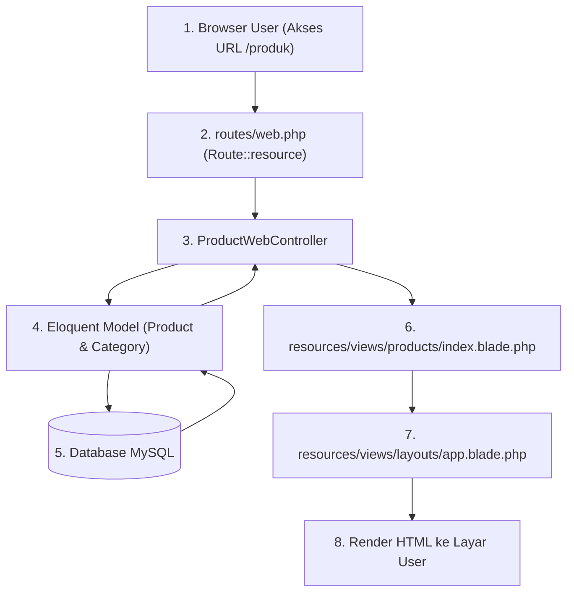

#E-Commerce Manajemen Produk 
[](https://laravel.com)
[](https://php.net)
[](https://getbootstrap.com)
[](https://mysql.com)
[-brightgreen?style=for-the-badge&logo=checkmarx&logoColor=white)](#-pengujian-otomatis-testing)

Aplikasi web manajemen katalog produk berbasis **Laravel 13 Blade** dengan relasi kategori dinamis, validasi Form Request, pagination, pencarian real-time, dan desain antarmuka modern

---

## Identitas Mahasiswa

* **Nama Lengkap:** M. Niko Nur Cahyono
* **NIM:** 2455201014
* **Mata Kuliah:** Pemrograman Berbasis Kerangka Kerja (PBKK)
* **Semester / Kelas:** Semester 5 · Teknik Informatika

---

## Dokumentasi Video Praktikum & Demo Proyek

Berikut adalah dokumentasi video pembelajaran dan demonstrasi proyek dari Pertemuan 1 hingga UTS:

| Pertemuan | Topik Pembelajaran | Tautan Video YouTube |
|:---:|---|:---:|
| **UTS (P-8)** | **Demonstrasi CRUD Produk, Relasi Kategori & Blade** | None|
| **P-3 & P-4** | Migrasi Database, Seeder, Factory, Eloquent ORM & Model Laravel | [Tonton Video (YouTube)](https://youtu.be/nnzRC3HOd4k?si=DvY3N8bSBpUdpxkp) |
| **P-2** | Routing, Controller, dan Request Handling | [Tonton Video (YouTube)](https://youtu.be/wA77bPqGU_4?si=-yNNIXqQvb97k64r) |
| **P-1** | Pengenalan & Konsep Dasar Laravel Framework | [Tonton Video (YouTube)](https://youtu.be/QGJXPrmIoBM?si=L1XaVdSnxa3MPGo4) |

---

## Fitur Utama Project 

| No | Komponen Soal UTS | Status | Implementasi & File Terkait |
|:--:|---|:---:|---|
| 1 | **Relasi Eloquent Model** | Selesai | `Category hasMany Product` dan `Product belongsTo Category`. Kolom `category_id` dan Seeder 5 kategori (`CategorySeeder`, `ProductSeeder`). |
| 2 | **Layout Utama (Master Layout)** | Selesai | [`resources/views/layouts/app.blade.php`](resources/views/layouts/app.blade.php) memuat Navbar, footer, `@yield('content')`, dan penampung flash message `session('success')`. |
| 3 | **Daftar Produk (`/produk`)** | Selesai | [`resources/views/products/index.blade.php`](resources/views/products/index.blade.php) menampilkan tabel Nama, Kategori, Harga (format Rupiah), Stok, Eager Loading (`Product::with('category')`), dan pagination Bootstrap 5. |
| 4 | **Tambah Produk** | Selesai | [`resources/views/products/create.blade.php`](resources/views/products/create.blade.php) dengan dropdown kategori dinamis, proteksi `@csrf`, validasi Form Request terpisah ([`ProductRequest.php`](app/Http/Requests/ProductRequest.php)), penanganan `@error`, dan `old()`. |
| 5 | **Edit Produk** | Selesai | [`resources/views/products/edit.blade.php`](resources/views/products/edit.blade.php) menampilkan data lama `old('field', $produk->field)`, method spoofing `@method('PUT')`, dan validasi yang sama. |
| 6 | **Hapus Produk** | Selesai | Form tombol hapus `@method('DELETE')` dengan dialog konfirmasi JavaScript `confirm()`, Soft Deletes, dan kembali dengan pesan sukses. |
| 7 | **Controller Terpisah** | Selesai | Menggunakan [`ProductWebController.php`](app/Http/Controllers/ProductWebController.php) di `routes/web.php`, terpisah dari API Controller. |
| 8 | **Fitur Tambahan (Pencarian & Filter)** | Selesai | Pencarian berdasarkan kata kunci nama/deskripsi produk dan filter cepat kategori dinamis. |

---

## Tampilan UI 
**Tampilan Utama** 

<br>
**Tampilan Tambah Data** 


<br>
**Tampilan Edit Data** 


## Konsep Blade yang Diterapkan

Proyek ini menerapkan konsep templating Blade secara komprehensif:

1. **`@extends('layouts.app')`:** Mewarisi struktur HTML master (Navbar, CSS, Footer) ke halaman anak.
2. **`@section('content')` & `@yield('content')`:** Wadah injeksi konten unik dari view anak ke layout induk.
3. **`@forelse ... @empty ... @endforelse`:** Looping data produk sekaligus menampilkan pesan informatif jika data kosong atau pencarian nihil.
4. **`@csrf`:** Proteksi keamanan Cross-Site Request Forgery pada setiap form HTTP.
5. **`@method('PUT')` & `@method('DELETE')`:** *Method Spoofing* agar HTML form dapat mengeksekusi rute standar RESTful API.
6. **`old('nama')`:** Mempertahankan isian user saat validasi form gagal agar tidak perlu mengetik ulang.
7. **`@error('nama') ... @enderror`:** Menampilkan umpan balik pesan validasi merah secara spesifik di bawah input.
8. **`session('success')`:** Menampilkan notifikasi alert hijau saat operasi Create, Update, atau Delete berhasil.
9. **`$products->links()`:** Merender tombol navigasi pagination secara otomatis berbasis Bootstrap 5.

---

## Alur Arsitektur Request (MVC Flow)



---

## Panduan Instalasi & Menjalankan Proyek

### 1. Prasyarat Sistem
* PHP >= 8.2
* Composer
* MySQL Server (Laragon / XAMPP)

### 2. Langkah Instalasi

```bash
# 1. Clone repository
git clone https://github.com/username/repository-name.git
cd repository-name

# 2. Install dependensi PHP
composer install

# 3. Salin environment file
cp .env.example .env

# 4. Generate Application Key
php artisan key:generate

# 5. Konfigurasi database di file .env
DB_CONNECTION=mysql
DB_HOST=127.0.0.1
DB_PORT=3306
DB_DATABASE=belajar_laravel
DB_USERNAME=root
DB_PASSWORD=

# 6. Jalankan migrasi dan seeder data
php artisan migrate:fresh --seed

# 7. Jalankan server lokal
php artisan serve
```

Akses aplikasi di browser melalui:  
**`http://localhost:8000/produk`** (atau via domain Laragon: `http://bejalar-laravel.test/produk`)

---

## Pengujian Otomatis (Testing)

Project telah dilengkapi dengan pengujian Feature Test otomatis (`tests/Feature/ProductCrudTest.php`) yang menguji seluruh skenario CRUD, relasi database, pencarian, dan validasi:

```bash
php artisan test
```

**Hasil Uji Coba:**
```text
   PASS  Tests\Unit\ExampleTest
  ✓ that true is true

   PASS  Tests\Feature\ExampleTest
  ✓ the application returns a successful response

   PASS  Tests\Feature\ProductCrudTest
  ✓ can display products index page
  ✓ can search products by name
  ✓ can display create product page
  ✓ can store product with valid data
  ✓ cannot store product with invalid data
  ✓ can display edit product page
  ✓ can update product
  ✓ can delete product
  ✓ relationship models

  Tests:    11 passed (37 assertions)
```

---

## Struktur Berkas Penting

```text
bejalar-laravel/
├── app/
│   ├── Http/
│   │   ├── Controllers/
│   │   │   ├── ProductWebController.php   # Controller web untuk CRUD Blade
│   │   │   └── ProductsController.php     # Controller API
│   │   └── Requests/
│   │       └── ProductRequest.php         # Validasi Form Request (nama, harga, stok, kategori)
│   └── Models/
│       ├── Category.php                   # Model Kategori (hasMany Product)
│       └── Product.php                    # Model Produk (belongsTo Category & SoftDeletes)
├── database/
│   ├── migrations/                        # Skema tabel products, categories, soft_deletes
│   └── seeders/
│       ├── CategorySeeder.php             # Seeder 5 kategori default
│       └── ProductSeeder.php              # Seeder data produk dummy
├── resources/
│   └── views/
│       ├── layouts/
│       │   └── app.blade.php              # Master layout (Navbar, footer, @yield)
│       ├── products/
│       │   ├── index.blade.php            # Daftar produk, pencarian, tabel, & pagination
│       │   ├── create.blade.php           # Form tambah produk
│       │   └── edit.blade.php             # Form edit produk
│       └── vendor/pagination/
│           └── bootstrap-5.blade.php      # Custom pagination template Bootstrap 5
├── routes/
│   ├── web.php                            # Rute Resource web produk (/produk)
│   └── api.php                            # Rute API RESTful
└── tests/
    └── Feature/
        └── ProductCrudTest.php            # 11 Unit/Feature automated tests
```

---

© 2026 **M. Niko Nur Cahyono** · Teknik Informatika · Pemrograman Berbasis Kerangka Kerja
